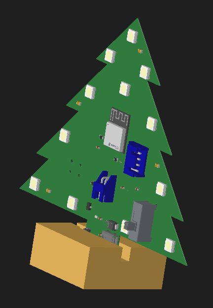
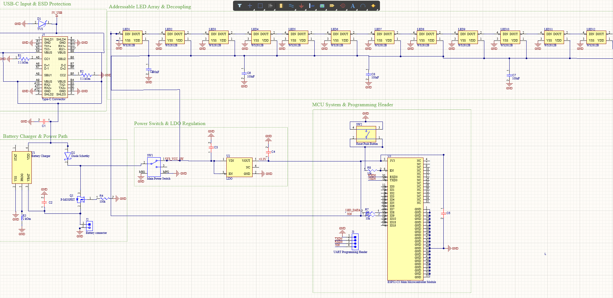
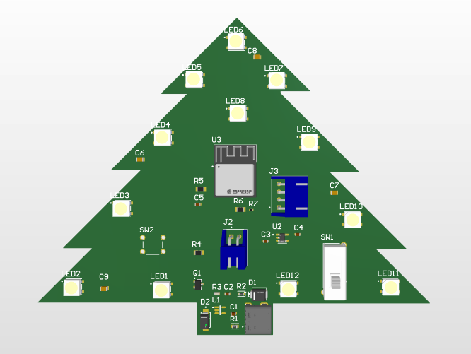
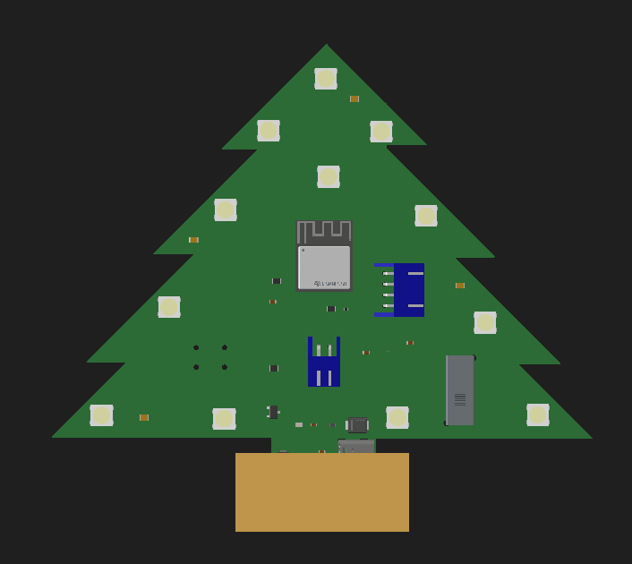
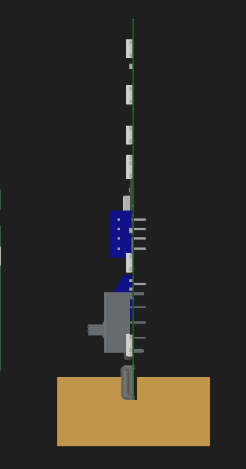

# LED Christmas Tree

Портативна електронна ялинка з 12 адресними RGB-світлодіодами WS2812B, мікроконтролером ESP32-C3 та підтримкою живлення від USB Type-C або Li-Ion/Li-Po акумулятора. Пристрій підтримує створення різнокольорових світлових ефектів, заряджання акумулятора та автоматичне перемикання джерела живлення.

## Основні характеристики

- **Мікроконтролер:** ESP32-C3-MINI-1-H4 з підтримкою Wi-Fi та Bluetooth LE.
- **Світлодіоди:** 12 адресних RGB-світлодіодів WS2812B.
- **Живлення:** USB Type-C (5 В) або Li-Ion/Li-Po акумулятор (3,7 В).
- **Контролер заряджання:** MCP73831T-2ACI/OT зі струмом заряджання приблизно 500 мА.
- **Power-Path:** схема перемикання джерел живлення на AO3401A та SS14.
- **Стабілізатор:** AP2112K-3.3 для отримання напруги 3,3 В.
- **Інтерфейси:** UART-роз'єм для прошивання та кнопка Reset.
- **Корпус / основа:** 3D-друкована підставка з вирізом під друковану плату та вільним доступом до порту USB Type-C.

## Принципова схема та друкована плата

### Електрична принципова схема

### Розведення друкованої плати (PCB)

## 3D-модель та підставка (FreeCAD)

Для зручного встановлення плати розроблено компактну підставку-основу зі ступінчастим пазом під товщину текстоліту та вирізом під роз'єм USB Type-C.

| Вигляд спереду | Вигляд збоку |
| :---: | :---: |
|  |  |

## Опис роботи пристрою

### Живлення та заряджання

Роз'єм USB Type-C забезпечує подачу живлення 5 В. TVS-діод захищає вхідні кола від електростатичних розрядів, а резистори на лініях CC забезпечують коректне визначення пристрою джерелом живлення. Контролер MCP73831 відповідає за заряджання акумулятора, а схема Power-Path забезпечує перемикання між зовнішнім живленням і акумулятором.

Головний перемикач керує ввімкненням пристрою, а стабілізатор AP2112K-3.3 формує напругу 3,3 В для мікроконтролера. Конденсатори використовуються для фільтрації живлення та зменшення перешкод.

### Мікроконтролер і керування

ESP32-C3-MINI-1-H4 виконує програму керування світлодіодами та формує сигнали для створення світлових ефектів. Кнопка Reset дає змогу перезавантажити мікроконтролер, а UART-роз'єм призначений для прошивання та налагодження пристрою за допомогою зовнішнього USB-UART-адаптера.

### Світлодіодний масив

Дванадцять світлодіодів WS2812B з'єднані послідовно, що дозволяє керувати кольором і яскравістю кожного з них окремо. Дані передаються з виводу IO8 мікроконтролера через резистор 330 Ом. Конденсатори забезпечують додаткову фільтрацію живлення світлодіодів.

## Структура файлів проєкту

### Altium Designer (електроніка та PCB)
- `ChristmasTree.PrjPcb` — головний файл проєкту Altium Designer.
- `ChristmasTreeLEDSchDoc.SchDoc` — принципова електрична схема.
- `PCB1.PcbDoc` — файл розведення друкованої плати.
- `ChristmasTree.OutJob` — конфігурація вихідної документації (Output Job).
- `ChristmasTree.pdf` — повна документація проєкту у форматі PDF.
- `ChristmasTreeLED.step` — 3D-модель зібраної друкованої плати.

### FreeCAD та 3D-друк (підставка)
- `led tree.FCStd` — вихідний проєкт підставки та збірки у FreeCAD.
- `led tree.3mf` — модель підставки, готова для слайсера та 3D-друку.

### Зображення для документації
- `altium_christmas_tree.png` — принципова електрична схема.
- `pcb.png` — вигляд розведення друкованої плати.
- `tree_isometry.png` — загальний ізометричний вигляд ялинки в підставці.
- `tree_front.png` — вигляд конструкції спереду.
- `tree_side.png` — вигляд конструкції збоку.
