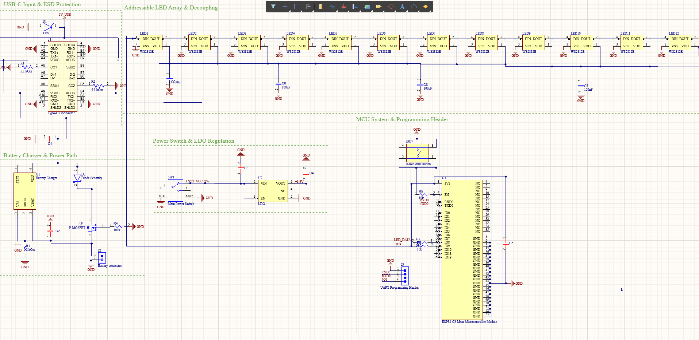

# LED Christmas Tree

Портативна електронна ялинка з 12 адресними RGB-світлодіодами WS2812B, мікроконтролером ESP32-C3 та підтримкою живлення від USB Type-C або Li-Ion/Li-Po акумулятора. Пристрій підтримує створення різнокольорових світлових ефектів, заряджання акумулятора та автоматичне перемикання джерела живлення.

## Принципова схема

## Основні характеристики

- **Мікроконтролер:** ESP32-C3-MINI-1-H4 з підтримкою Wi-Fi та Bluetooth LE.
- **Світлодіоди:** 12 адресних RGB-світлодіодів WS2812B.
- **Живлення:** USB Type-C (5 В) або Li-Ion/Li-Po акумулятор (3,7 В).
- **Контролер заряджання:** MCP73831T-2ACI/OT зі струмом заряджання приблизно 500 мА.
- **Power-Path:** схема перемикання джерел живлення на AO3401A та SS14.
- **Стабілізатор:** AP2112K-3.3 для отримання напруги 3,3 В.
- **Інтерфейси:** UART-роз'єм для прошивання та кнопка Reset.

## Опис роботи пристрою

### Живлення та заряджання

Роз'єм USB Type-C забезпечує подачу живлення 5 В. TVS-діод захищає вхідні кола від електростатичних розрядів, а резистори на лініях CC забезпечують коректне визначення пристрою джерелом живлення. Контролер MCP73831 відповідає за заряджання акумулятора, а схема Power-Path забезпечує перемикання між зовнішнім живленням і акумулятором.

Головний перемикач керує ввімкненням пристрою, а стабілізатор AP2112K-3.3 формує напругу 3,3 В для мікроконтролера. Конденсатори використовуються для фільтрації живлення та зменшення перешкод.

### Мікроконтролер і керування

ESP32-C3-MINI-1-H4 виконує програму керування світлодіодами та формує сигнали для створення світлових ефектів. Кнопка Reset дає змогу перезавантажити мікроконтролер, а UART-роз'єм призначений для прошивання та налагодження пристрою за допомогою зовнішнього USB-UART-адаптера.

### Світлодіодний масив

Дванадцять світлодіодів WS2812B з'єднані послідовно, що дозволяє керувати кольором і яскравістю кожного з них окремо. Дані передаються з виводу IO8 мікроконтролера через резистор 330 Ом. Конденсатори забезпечують додаткову фільтрацію живлення світлодіодів.

## Файли проєкту Altium Designer

- `ChristmasTree.PrjPcb` — головний файл проєкту Altium Designer.
- `ChristmasTreeLEDSchDoc.SchDoc` — принципова електрична схема.
- `schematic.png` — графічне зображення схеми для документації.
